# Quantitative Research and Market Microstructure Platform

A Python research platform for short-horizon market-microstructure questions. It is built to
make temporal leakage and optimistic backtests hard to produce by accident. It takes
market-data events from ingestion through validated, versioned storage, causal feature
computation, purged walk-forward evaluation and conservative simulated execution, to a report
whose conclusions are computed from the numbers.

The goal is to separate evidence from noise, not to find a profitable strategy. The one real
experiment so far finds a strong, statistically robust predictive signal that is worthless to
a taker after costs. The report says so.

## Results so far

| Experiment | Data | Finding |
|---|---|---|
| [E2: LINKUSDT order-book state → 10 s mid return](reports/linkusdt_imbalance.md) | Real: Binance spot via Tardis.dev, develop on 2024-03-01, single test on 2024-04-01 (pre-registered) | Test rank IC **0.254 [0.241, 0.269]**, OOS R² vs zero **0.028 [0.022, 0.034]**. The cost-aware strategy never trades (largest forecast 8 bp vs 20.5 bp round-trip cost). A diagnostic strategy that ignores costs earns 0.55 bp of edge, then pays 0.88 bp of spread and 10 bp of fees per unit notional. Break-even fee: −0.33 bp. All 7 negative controls pass. |
| [E1: synthetic demo](reports/synthetic_demo.md) | **Synthetic** zero-intelligence book | Pipeline check only: recovers the generator's known imbalance signal (test IC 0.26) and shows the same signal-vs-cost pattern. Says nothing about real markets. |

Plans, results and a disclosure of the one exploratory look at development data are in
[`docs/experiment_log.md`](docs/experiment_log.md).

## How it works

```mermaid
flowchart LR
    A["events: Project 1/2 export (qrp.events.v1),<br/>Tardis CSV, synthetic generator"] --> B["adapters<br/>(representation only)"]
    B --> C["validate<br/>18 checks, per-stream sequencing"]
    C --> D[("catalog<br/>immutable versions,<br/>Parquet symbol=/date=")]
    D --> E["book reconstruction<br/>gap → unsynced until snapshot"]
    E --> F["features + labels<br/>availability clock, as-of joins"]
    F --> G["purged walk-forward<br/>model selection (dev only)"]
    G --> H["single test evaluation<br/>bootstrap CIs, nulls, regimes"]
    H --> I["event-driven backtest<br/>latency, depth, fees"]
    H --> J["negative controls"]
    I --> K["report.md<br/>mechanical conclusions"]
    J --> K
```



The decisions that matter, each enforced in code and tested:

* **Three timestamps, one research clock.** Exchange time (`event_time_ns`) and capture time
  (`recv_time_ns`) are stored separately and both may be null; nothing is invented at import.
  Research uses an *availability time*: receive time if measured, otherwise exchange time plus
  a latency assumption that the experiment config must state explicitly. Dataset knowledge
  time (manifest `created_at_ns`) governs revisions.
  [architecture.md §2](docs/architecture.md#2-data-model)
* **Feed-specific sequencing.** Each `(symbol, stream)` declares whether its sequence numbers
  are `contiguous`, `monotonic` or adapter-`derived`. Only a contiguous stream can prove loss.
  When it does, the reconstructed book is marked unsynced until the next snapshot, and those
  rows never reach features, labels or fills.
* **Causal features by construction.** Point values are backward as-of joins on availability
  time. Window values are cumulative-sum differences over `(t − W, t]`. A truncation test checks
  that deleting all data after `T` leaves every feature at `t ≤ T` unchanged.
  [features.md](docs/features.md)
* **Holdout discipline.** Model choice and hyper-parameters come from purged, embargoed
  walk-forward folds on development data. The test period is read once, after selection. Each
  run records how many earlier runs of the same experiment touched the test set.
* **Conservative execution.**
  * Only marketable IOC orders are simulated. They reach the venue after configured latencies
    and walk the depth that was visible at arrival time.
  * Any remainder is cancelled, liquidity already taken is not offered again, and the order
    pays spread, slippage and fees.
  * Passive fills are not simulated, because queue position is unknowable from L2 data.
  * Fills are flagged `simulated`, and the ledger rejects any fill better than the touch.
* **Controls with pass criteria.** The controls are:
  * shuffled and time-rotated labels, and shuffled features;
  * a future-label canary that the truncation test must catch;
  * a nearest-in-time model that scores IC 0.92 under unpurged shuffled K-fold and 0.008
    under purged walk-forward;
  * random-signal and null strategies.

## Quick start

Requires [uv](https://docs.astral.sh/uv/) and Python ≥ 3.11.

```bash
git clone https://github.com/kennethcxv/Quantitative-Research-and-Market-Microstructure-Platform.git
cd Quantitative-Research-and-Market-Microstructure-Platform
uv sync --locked
uv run pytest                 # unit, property-based, integration and determinism tests
scripts/demo.sh               # synthetic end-to-end run, ~1 minute
```

Real-data experiment (downloads ~70 MB from Tardis.dev; check their licence first):

```bash
uv run qrp fetch-tardis --date 2024-03-01 2024-04-01
uv run qrp import --name tardis_binance_linkusdt --tardis 2024-03-01 2024-04-01
uv run qrp run --config configs/linkusdt_tardis.toml
```

The import should report dataset version `34bcccee27a08362`. With the locked dependencies, a
rerun on the same platform reproduces the numbers in `reports/linkusdt_imbalance.md` exactly;
only the run id, timestamps and prior-evaluation counter change. Run-to-run determinism is
checked by `tests/test_pipeline.py::test_rerun_is_deterministic_and_counts_test_evaluations`.
Other CPU architectures may differ in the last floating-point digits.

### Commands

| Command | Does |
|---|---|
| `qrp fixture --out F` | write the synthetic feed as a `qrp.events.v1` file plus sidecar |
| `qrp fetch-tardis` | download and hash-check the free Tardis.dev samples |
| `qrp import --name N (--qrp-v1 F \| --tardis DATES)` | normalise, validate, deduplicate and store an immutable version (`--revises V --note` for corrections) |
| `qrp validate --name N` | re-hash stored files and print the integrity report |
| `qrp features --config C --out F` | compute the feature table, for exploration |
| `qrp run --config C` | select, test once, evaluate, backtest, run controls, write `report.md` |
| `qrp evaluate / backtest / controls / report RUN_DIR` | re-run one stage of an existing run without reselecting |
| `qrp bench` | the benchmark suite in [docs/benchmarks.md](docs/benchmarks.md) |

Logs are one JSON object per line on stderr.

## Performance

Measured, not estimated; method and caveats in [docs/benchmarks.md](docs/benchmarks.md). On
6.06 M synthetic rows (M-series Mac):

* **Ingestion:** CSV → partitioned Parquet takes 0.36 s with Polars versus 1.71 s with pandas.
* **Storage:** 448 MB of CSV becomes 66 MB of zstd Parquet.
* **Queries:** a one-symbol-day query costs 7–22 ms with Polars or DuckDB versus 119 ms and
  1 GB peak RSS for naive pandas. pandas with partition filters gets most of the way (35 ms),
  so the layout matters more than the engine.
* **Real data:** imports at 9.3 M rows in 5.3 s including validation. Book reconstruction is
  the sequential bottleneck at 0.58 µs per row. One optimisation cut it 7% on real data and 23%
  on synthetic. Why the gain was small, and what a compiled version would change, is written up
  in the benchmark notes.

## Integration with Projects 1 and 2

[`docs/event_interface.md`](docs/event_interface.md) specifies `qrp.events.v1`: the columns,
message atomicity, snapshot semantics, the JSON sidecar and the versioning policy. The C++
market-data engine (Project 1) and the distributed event log (Project 2) should export it.
Neither repository has code yet. `tests/fixtures/project1_feed.ndjson` is a small, openly
licensed reference feed in that format. It contains a multi-level sweep, a sequence gap and a
recovery snapshot, and `tests/test_pipeline.py` imports it through the same path a real
export would take. Real-data paths: adapters, validation, catalog, book, features,
evaluation. Simulation: execution and P&L only.

## Limitations

* **No passive execution, no persistent impact.** Our orders do not move later historical
  prices. The decomposition shows the signal could only pay if the strategy earned the spread
  instead of crossing it, and that is exactly what this simulator cannot assess honestly.
* **Two real days, one instrument.** The E2 test is a single day. Its confidence intervals
  describe within-day sampling error, not day-to-day or regime variation; the drop from dev
  R² 0.058 to test 0.028 is a reminder of that.
* **Vendor capture times.** Tardis timestamps reflect their collector's location. Latency
  parameters are assumptions, and nothing here is a claim about achievable live latency.
* **Depth-channel batching.** Binance spot depth is batched every 100 ms, so OFI is computed
  per batch and the exchange-side book can lag trades.
* **Python book reconstruction** at ~1.7 M rows/s is fine for days of data and too slow for
  years.

## Repository layout

```
src/qrp/        schemas, validate, catalog, adapters, synth, book, features, splits, models,
                stats, experiment, controls, report, bench, cli, log, backtest/
tests/          unit, Hypothesis property tests, end-to-end, determinism, interface fixture
configs/        experiment configs (synthetic demo, real-data E2)
reports/        generated research reports committed for reference
docs/           architecture, event interface, features, data, benchmarks, experiment log,
                engineering journal, status
```

## How this was built

The code, tests and documents were written with an AI coding assistant (Claude Code) working
under the repository owner's direction and review. The engineering journal
([`docs/journal.md`](docs/journal.md)) records each milestone and its test results, including
mistakes and design changes such as the timestamp and sequencing model being reworked after
review. Commit history reflects the actual order of work.

Licence: MIT for the code. Data licences are listed in [docs/data.md](docs/data.md).
